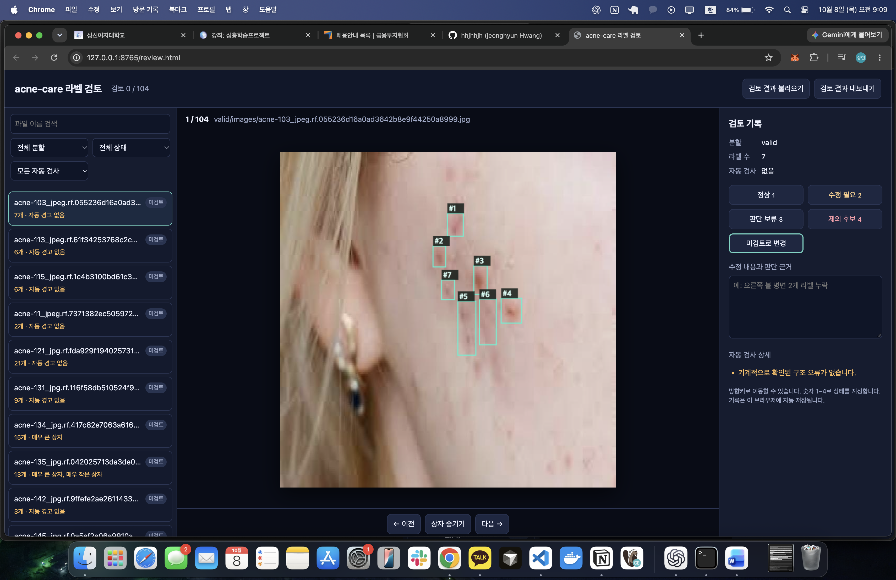
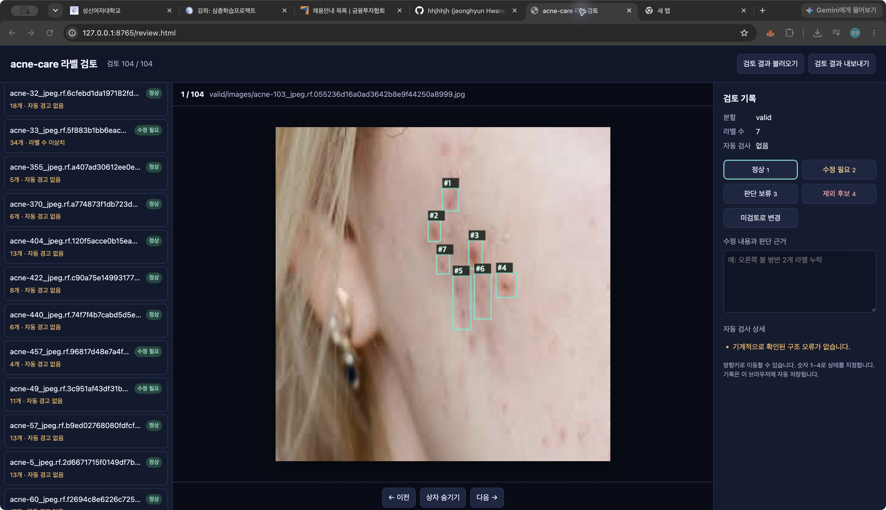
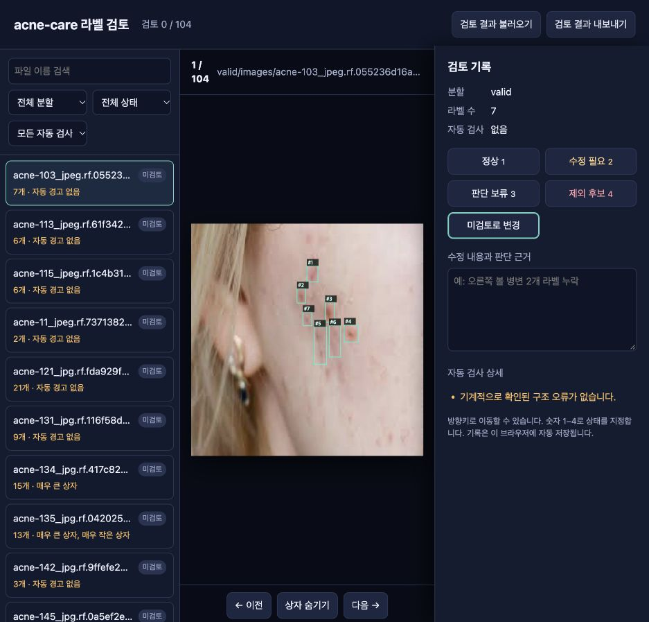
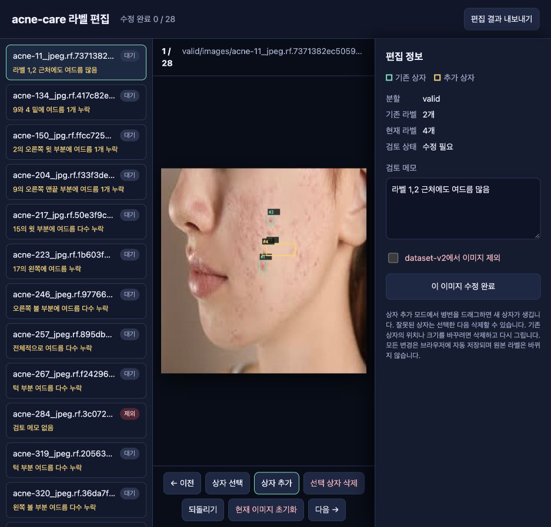
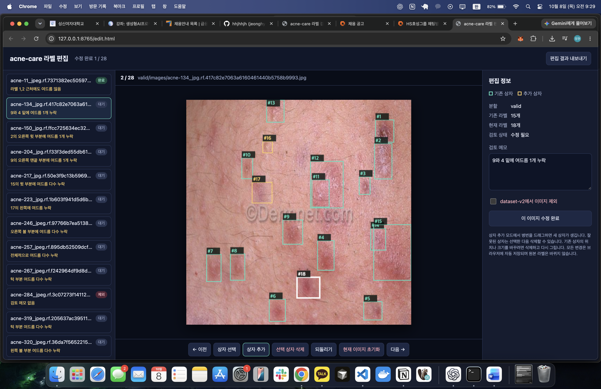
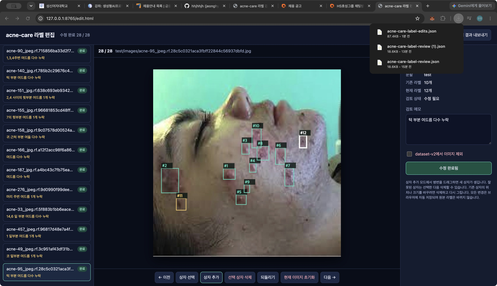

# Validation·Test 라벨 검토 기록

## 검토 범위

2026년 10월 8일에 `acne-care 라벨 검토` 화면으로 Validation 56장과 Test 48장을 확인했다. 화면에는 기존 YOLO 라벨만 표시했으며 모델 예측은 표시하지 않았다.

| 분할 | 전체 | 정상 | 수정 필요 | 제외 후보 |
|---|---:|---:|---:|---:|
| Validation | 56 | 39 | 15 | 2 |
| Test | 48 | 37 | 11 | 0 |
| 합계 | 104 | 76 | 26 | 2 |

수정 필요로 분류한 26장에는 라벨 누락 위치에 관한 메모가 저장되어 있다. 검토 결과의 원본은 [`label-review-2026-10-08.json`](./label-review-2026-10-08.json)이다. 이 단계에서는 원본 이미지와 라벨을 변경하지 않았다.

## 발표 자료용 화면

### 검토 화면 전체 모습

### 검토 완료 상태

### 생성 직후 화면

### 누락 라벨 편집 화면

민트색은 기존 상자이고 노란색은 새로 추가한 상자이다. 편집 결과는 원본 라벨을 덮어쓰지 않고 별도 JSON으로 저장한다.

### 실제 편집 장면

### 편집 완료 상태

## 편집 결과

편집 대상 28장을 모두 완료했다. 편집 결과의 원본은 [`label-edits-2026-10-08.json`](./label-edits-2026-10-08.json)이다.

| 항목 | 결과 |
|---|---:|
| 수정 완료 이미지 | 28장 |
| 제외 이미지 | 2장 |
| 새로 그린 상자 | 93개 |
| 제외 이미지를 뺀 추가 상자 | 85개 |
| dataset-v2에 포함할 기존 상자 | 268개 |
| dataset-v2에 포함할 편집 후 상자 | 353개 |

Validation에서는 68개, Test에서는 25개의 상자를 새로 그렸다. 제외 이미지 2장에 그린 상자 8개는 dataset-v2에서 사용하지 않는다.

## 다음 처리

검토와 편집 결과를 `dataset-v2`에 반영한다. 제외로 확정한 2장은 새 분할에서 제거하고, 기존 데이터는 비교 재현을 위해 그대로 보존한다.
